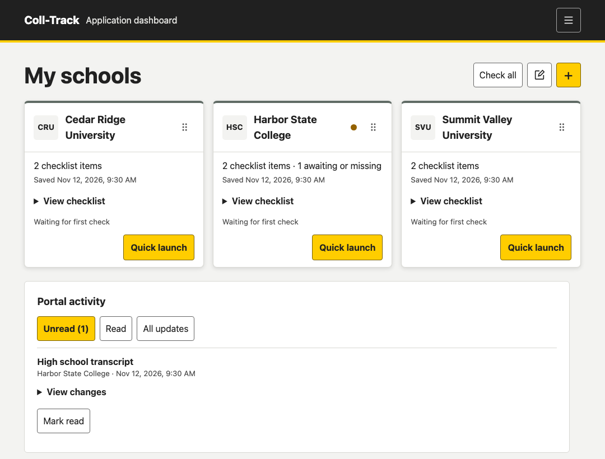
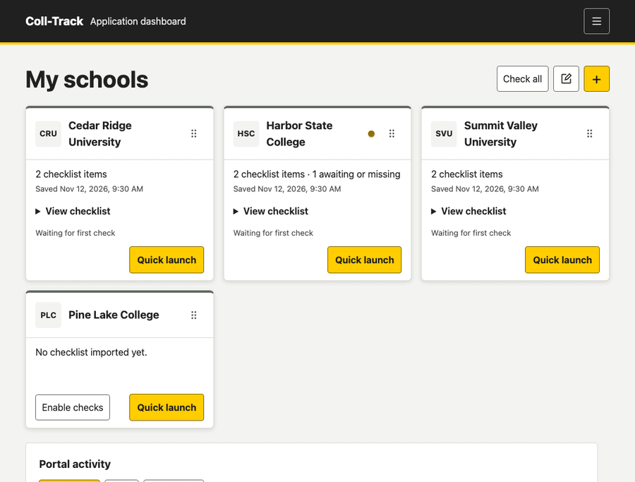
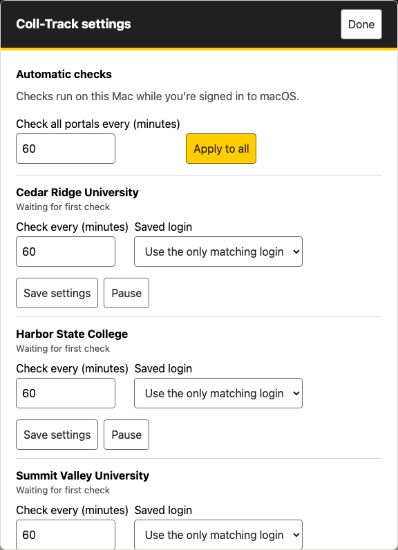
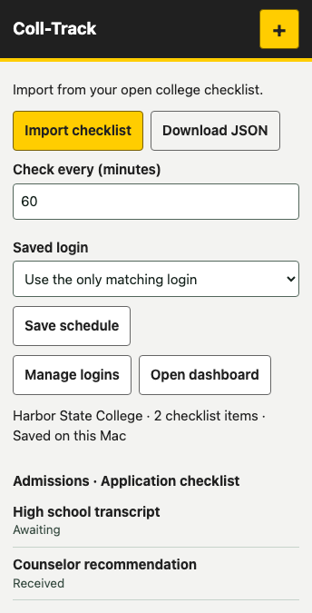

# Coll-Track

Track college application checklists from a dashboard, Chrome extension, or terminal. Coll-Track saves your schools, logins, and check history on your Mac.

**Early prototype.** Portal support varies. Confirm deadlines, decisions, and required documents in the university portal.



[Install](#install-on-macos) · [Add a school](#add-a-school) · [Check for updates](#check-for-updates) · [Chrome extension](#import-from-chrome) · [Terminal](#use-coll-track-in-the-terminal)

## Install on macOS

Install Python 3.9 or later and the Xcode command-line tools. The terminal options also require Rust 1.89 or later. Chrome is needed for the extension.

```sh
git clone https://github.com/AnthonyHernandezN09/coll-track.git
cd coll-track
python3 backend/install-macos.py
```

| Installer option | What you get |
| --- | --- |
| **Default** | Dashboard, CLI, terminal menu, and the folder path to load in Chrome |
| **Lite** | CLI and terminal menu, with the dashboard disabled |
| **Custom** | Your choice of dashboard, CLI, terminal menu, and Chrome extension setup instructions |

Press Enter to choose Default. Every option installs the same local service. For scripted installs, use `--preset default`, `--preset lite`, or `--preset custom` with any of `--dashboard`, `--cli`, `--tui`, and `--extension`.

## Add a school

1. Open the [local dashboard](http://127.0.0.1:46387/) and click **+** beside **My schools**.
2. Enter the school name and its application **status page** URL. Use the page that shows your checklist after you sign in.
3. Under **Portal login**, choose an existing default login, create one to reuse, or save a separate login for this school. You can also set it up later.
4. Click **Save school**. Open **View checklist** on the card once a check or import has saved your checklist.


**Quick launch** opens the portal. With the extension loaded, it can sign in on supported Slate portals or help you set up a missing login. Use the global pencil button to edit or remove a school. Drag a card by its handle to reorder it, or focus the handle and use the arrow keys.

## Check for updates

- **Check all** queues a one-time check for every saved school. **Unread** shows changes you haven’t marked as read.
- **Enable checks** on a school card starts scheduled checks. Open **Settings → Automatic checks** to change the interval, choose a saved login, or pause checks.
- The first successful check creates a baseline. Checklist changes can appear after one successful check. Page-only changes need confirmation on a second successful check. Failed or unreadable scans keep the last good snapshot.





Scheduled checks run while your Mac is awake and you’re signed in to macOS. You can close Chrome and the dashboard. If a portal requires verification, sign in manually and import the checklist with the extension.

## Import from Chrome

1. In Chrome, open `chrome://extensions` and turn on **Developer mode**.
2. Click **Load unpacked** and select the folder printed by the installer. This is the repository folder containing `manifest.json`.
3. Sign in to your school portal and open the page that shows your checklist. Open the Coll-Track extension and click **Import checklist**.
4. Review the preview. The extension saves the checklist to the local service when it’s available. Choose **Download JSON** to keep a copy or **Save schedule** to turn on scheduled checks.



## Use Coll-Track in the terminal

Run `cltrk-tui` or `cltrk menu` for the interactive menu. Use the arrow keys or number keys to choose **My schools**, then select a school. The launchers live in `~/.local/bin`. Add it to your `PATH` if your shell can’t find them.

```sh
cltrk list
cltrk check-now SCHOOL
cltrk view-checklist SCHOOL
cltrk view-updates SCHOOL
cltrk update SCHOOL --from-json checklist.json
cltrk track SCHOOL 60
```

Replace `SCHOOL` with a short name or portal hostname from `cltrk list`. `cltrk save-default-login SCHOOL_A SCHOOL_B` saves one login for the selected schools, and `cltrk use-default-login SCHOOL_C` assigns it to another. `cltrk save-login SCHOOL` saves a separate login. Terminal login prompts show what you type.

`cltrk quick-launch SCHOOL` creates a one-time link that opens a dedicated Chrome or Chromium window. Keep the terminal open until you use it. Use `cltrk --offline` for the earlier separate Rust store, or `cltrk migrate SCHOOL` to copy a school registration into the shared service.

## Local data

The dashboard listens on localhost. Checklists, settings, and encrypted login profiles live under `~/Library/Application Support/Coll-Track`. Keep that folder and checklist exports out of Git. Brandfetch is optional and requires your own API key. The screenshots and GIFs above use sample data.

## License and university portal use

Coll-Track is released under the [MIT License](LICENSE). You may use, modify, share, or sell the code, including in commercial projects. Keep the license and copyright notice crediting Anthony Hernandez with copies or substantial portions of the code.

Coll-Track and its browser extension interact with university portals, including signing in and reading application information. Use them only with accounts you are authorized to access and in accordance with each university’s rules. Universities control their portals and may restrict automated access or take action on accounts or applications.

To the extent permitted by applicable law, Anthony Hernandez is not liable for lost, corrupted, or unavailable information, or for any action taken by a university in connection with your use of Coll-Track, including blocked access, account suspension, or action affecting an application. Coll-Track is provided as is, without warranty, under the terms of the MIT License.
